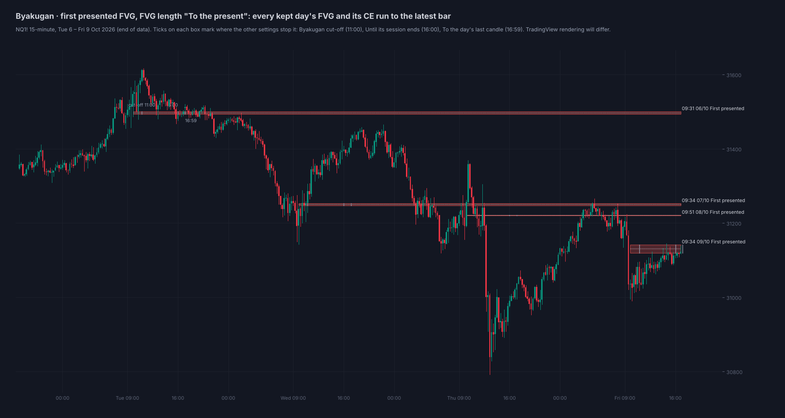
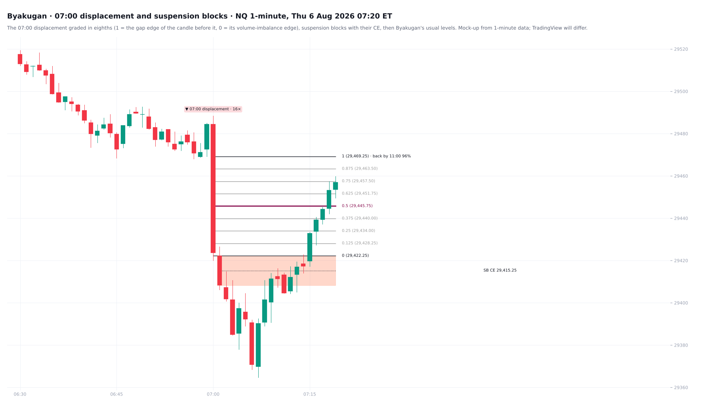
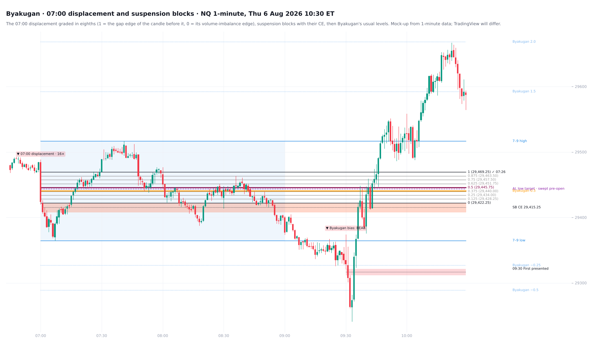

# Byakugan

**The 7-9 AM range and the first presented FVG for NQ and ES**

TradingView indicator, Pine Script v6. Open source under the Mozilla Public License 2.0.

*Mock-up of how it looks on the chart.*

**Byakugan** reads the 07:00–09:00 ET premarket range and the first presented fair value gap of the session. On 1-minute charts it also grades the 07:00 displacement and marks suspension blocks.

## What it draws

**The 7–9 AM range** (07:00–09:00 ET), drawn while it forms (the box grows with price, its 0.5 forming inside), then:
- its high, low and midpoint (0.5);
- an optional shaded box;
- levels that run from the range open to the cut-off (11:00 ET by default).

**The first 30 minutes** (07:00–07:30): its high and low, drawn as they form and run to the cut-off, with an optional EQ and a vertical line at 07:30. NQ + ES + RTY 2018–26:
- it already held the 7–9 high on 31% of days and the 7–9 low on 31%;
- by 09:00 one side was taken on 58% of days and both on 40% (neither: 2%);
- by 11:00 at least one side was taken on 99.9% of days, both on 76%;
- on average it is 46% of the full 7–9 range.

**Its EQ against the Byakugan 0.5, tested** (FOMC, CPI and NFP days left out, 5,443 days):
- **No directional edge.** Whether the first 30 minutes' EQ sits above or below the Byakugan 0.5 says nothing about the NY AM direction, the day's direction, the 16:00 close against the 0.5, or how often the 09:30 bias is right.
- **Which 7–9 extreme goes first.** It points to the side the range grew to after 07:30: about 65%, and 73% when the two EQs are a quarter of the range apart. But that is where price already is. Against a random walk from the 09:30 open it adds 3 points (p 0.07), not enough to call an edge.

**Labels** at the same spot and nearly the same price (within 0.5% of ADR20) share one label, listed top to bottom (the Session Map's fix).

**Extensions** in multiples of the range:
- 1.5, 2.0 and 2.5 in the direction of travel;
- −0.25, −0.5, −1.25 and −1.5 beyond the origin;
- your own custom levels.

**The 09:30 bias:** the open against the midpoint.

**The Asia / London target:** the Asia (20:00–00:00) or London (02:00–05:00) high or low in the bias direction, with its distance zone tagged on the label.

**The first presented FVG:** the first fair value gap of the session (09:30–16:00 by default) that completes within 30 minutes of the open. It is drawn with its CE (50%) and its reflection, the first opposite-direction FVG after it. The FVG can run to:
- the Byakugan cut-off (11:00);
- the session end (16:00);
- the trading day's last candle (16:59);
- the present.

## The 07:00 displacement and suspension blocks (1-minute charts)

From ICT's Price Action Chronicles session "The Science of Anticipation" (NQ, Thu 6 Aug 2026). The levels below reproduce his chart to the tick.

**The 07:00 displacement** is the largest-body 1-minute candle in 07:00–07:14 ET. It counts when two things hold:
- its body is at least 5× the 06:00–06:59 median body;
- it leaves a fair value gap.

That happens on about 1 day in 4.

It is graded ICT's way, in eighths:
- 1 = the gap edge of the candle before it;
- 0 = its volume-imbalance edge.

On 6 Aug that gave 29,469.25 → 29,422.25, with the 0.5 at 29,445.75. The 1 carries:
- the live odds that price comes back to it by 11:00;
- then ✓ and the time once it does.

**Suspension blocks:** a candle body with a volume imbalance on both sides (ICT's term), marked with its CE. By default only blocks in the displacement's own leg are shown, as in his example: the 07:01 body, CE 29,415.25, his long entry.

**What the tests showed** (NQ, ES and RTY 1-minute, 2018–26, 1,571 displacements). Each rule is scored against a driftless random walk from the same price, so an edge has to beat chance, not just distance.

- **Held:** price came back to the displacement's 1 by 09:00 on **84%** of these days and by 11:00 on **92%**. This was steady in 2018–24 and 2025–26 and on each symbol.
  - The live odds use the distance to the 1 (in 06:00–06:59 median bodies) and the time left.
  - Scored on 2025–26, the Brier score fell from 0.173 to 0.153.
- **Not found:** "bodies laying above the midpoint". A close beyond the 0.5 reached the 1 before the 0 on 63.5% of occasions, against 64.9% for a random walk. No other eighth beat the walk either.
- **Not found:** a 07:00 move into a daily FVG or inverted FVG reversing more often. Once the leg's size is held, there is no difference.
- **Not found:** the suspension block's CE as a turning point. From it, price went on or back 50/50, like any candle's midpoint, and it was revisited slightly less often.
- **Not found:** "the upper half of a gap held" as strength. The raw edge (47% vs 42%) is distance alone; adjusted for the walk, it is gone.

So the fib and the blocks are a map of ICT's read. The odds on the 1 are the tested part.

Scripts: `research/` (no market data included).

## Settings

**View** sits at the top:
- theme;
- text size and colour;
- label date format and side;
- days to keep;
- how older days fade.

## How to use

- Built for **NQ / MNQ** and **ES / MES**, on intraday charts of 15 minutes or less.
- Theme: Auto follows the chart background. Any colour you pick overrides it.

## Credits

- First presented FVG concept: ICT (Michael J. Huddleston).
- 07:00 displacement grading and suspension blocks: ICT, Price Action Chronicles "The Science of Anticipation" (Aug 2026).
- Inspired by "ICT 1st Presented FVG" by tristanlee85; detection written from scratch here.

## Add it to TradingView

1. In TradingView, open the **Pine Editor** (bottom panel).
2. Copy the contents of `Byakugan_FPFVG.pine` into a new script.
3. **Save**, then **Add to chart**.

## License

Mozilla Public License 2.0, see [LICENSE](LICENSE). © Unclehk2000.

*Historical frequencies, not guarantees. Nothing here is financial advice.*
